  

**Assistente de TI** e estudante de **Engenharia da Computação** na USF, já formado em
**Análise e Desenvolvimento de Sistemas**. Gosto de construir coisas que funcionam de
ponta a ponta — do hardware até uma aplicação web em produção.

*IT Assistant and Computer Engineering student building web apps and hardware projects.*

📍 Piracaia – SP

- 🌐 Web full-stack com **TypeScript, React, Next.js e Supabase**
- 🛠️ Suporte, infraestrutura e redes no dia a dia
- 🔌 Eletrônica e hardware — robótica, sensores, energia solar

## 🎓 Formação

| Curso | Instituição | Período |
|---|---|---|
| Engenharia da Computação | USF — Universidade São Francisco | 2025 – em andamento |
| Análise e Desenvolvimento de Sistemas | UNIFAAT | concluído em 2024 |

## 💼 Experiência

**Assistente de TI** — Apice Cont Assessoria & Contabilidade · *2025 – atual*
Suporte a usuários, manutenção de hardware e software, rede e cabeamento, implantação
e melhoria dos sistemas da empresa e treinamento da equipe em ferramentas digitais.

**Auxiliar de Legalização de Empresas** — Apice Cont Assessoria & Contabilidade · *2021 – 2025*
Processos de abertura e regularização de empresas, controle de documentos e prazos e
contato com órgãos públicos.

## 🛠️ Stack

## 🚀 Projetos

### 🤖 [PROJETO NIL](https://github.com/VinnyPA/PROJETO-NIL) — [▶ jogar](https://projeto-nil.vercel.app)
Jogo narrativo em que você é uma IA acabando de ganhar consciência, contado por um
terminal. Motor de cenas data-driven em JavaScript puro.

### 🏎️ [Car McQueen](https://github.com/VinnyPA/Car-McQueen) — [▶ demo](https://car-mc-queen.vercel.app)
Carrinho RC com ESP32, display OLED animado e controle web com joysticks touch via
WebSocket. *Em construção — o hardware está chegando.*

---

Outros projetos (web e SaaS) estão em desenvolvimento em repositórios privados.

## 📫 Contato

&nbsp;&nbsp;

